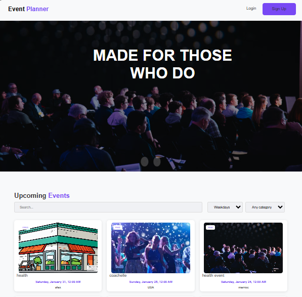

# 🎟️ EventPlanner

[](https://laravel.com)
[](https://www.php.net)
[](https://www.mysql.com)
[](https://tailwindcss.com)
[](https://vitejs.dev)
[](LICENSE)

[Features](#-features) · [Architecture](#%EF%B8%8F-architecture) · [Installation](#-installation) · [Preview](#-application-preview)

**Full-Stack Event Management Platform**

EventPlanner is a web application built with **Laravel**, **MySQL** and **Tailwind CSS**. Visitors can browse upcoming events, registered users can sign up for the events they like, and administrators manage events, categories and registrations from a dedicated dashboard.

---

## ✨ Overview

EventPlanner follows the **MVC architecture** of Laravel, with a clear separation between routing, controllers, business rules, Eloquent models and Blade views.

```
Browser
   │
   │ HTTP
   ▼
Routes (web.php)
   │
   ▼
Middleware (auth, ms_admin)
   │
   ▼
Controllers
   │
   ▼
Eloquent Models
   │
   ▼
MySQL Database
```

---

# 🚀 Features

## 👤 Roles

EventPlanner has three levels of access:

| Role | Description |
|------|-------------|
| **Visitor** | Browses the public event pages |
| **User** | Registers an account, signs up for events and manages their registrations |
| **Admin** | Manages events, categories and the administration dashboard |

### Visitor / User

- Browse the list of events
- View event details
- Filter events by category
- Create an account and log in
- Register for an event
- Cancel their own registration

### Admin

- Dashboard with platform statistics
- Create, edit and delete events
- Create, edit and delete categories
- Control access with a dedicated admin middleware

---

# 🔄 Registration Workflow

```
Browse Events
      ↓
Event Details
      ↓
Log in / Create Account
      ↓
Register for Event
      ↓
Check Capacity
      ↓
Save Registration
      ↓
View / Cancel Registration
```

---

# 🗃️ Domain Model

```
User
 └── Registrations

Category
 └── Events

Event
 ├── Category
 └── Registrations

Registration
 ├── User
 └── Event
```

Main models:

```
User
MS_Category
MS_Event
MS_Registration
```

Database structure is managed with **Laravel migrations**, and demo data is created with **factories and seeders**.

---

# ⚙️ Architecture

### Routes
Define public, authenticated and admin routes. Admin routes are grouped under the `admin` prefix and protected by the `auth` and `ms_admin` middleware.

### Middleware
`MS_AdminMiddleware` restricts the administration area to administrators.

### Controllers
Controllers are organised by audience:

```
Controllers/
├── Auth/        → login, registration, sessions
├── MS_Front/    → public event pages
├── MS_User/     → registrations of the logged-in user
└── MS_Admin/    → events, categories, dashboard
```

### Models
Eloquent models describe the entities and their relationships.

### Views
Blade templates styled with Tailwind CSS, with separate views for the public site and the admin area.

### Validation
Incoming data is validated in the controllers before it reaches the database.

---

# 🛠️ Technology Stack

| Technology | Purpose |
|------------|---------|
| PHP 8.2 | Backend language |
| Laravel | Application framework |
| Eloquent ORM | Database access |
| MySQL / MariaDB | Database |
| Blade | Templating |
| Tailwind CSS | Styling |
| Vite | Asset bundling |
| PHPUnit | Automated tests |
| Laravel Pint | Code formatting |

---

# 📂 Project Structure

```
EventPlanner/
│
├── .env.example
├── .gitignore
├── LICENSE
├── README.md
│
└── EventPlanner/
    ├── app/
    │   ├── Http/
    │   │   ├── Controllers/
    │   │   │   ├── Auth/
    │   │   │   ├── MS_Admin/
    │   │   │   ├── MS_Front/
    │   │   │   └── MS_User/
    │   │   └── Middleware/
    │   └── Models/
    ├── bootstrap/
    ├── config/
    ├── database/
    │   ├── factories/
    │   ├── migrations/
    │   └── seeders/
    ├── public/
    ├── resources/
    │   ├── css/
    │   ├── js/
    │   └── views/
    ├── routes/
    ├── tests/
    │   └── Feature/
    ├── composer.json
    ├── package.json
    └── vite.config.js
```

---

# 🚀 Installation

## Prerequisites

- PHP 8.2 or later
- Composer
- Node.js 20 or later and npm
- MySQL or MariaDB (XAMPP works well on Windows)

## 1. Clone the repository

```bash
git clone https://github.com/smidamanar/EventPlanner.git
cd EventPlanner/EventPlanner
```

## 2. Install dependencies

```bash
composer install
npm install
```

## 3. Configure the environment

```bash
# Windows
copy ..\.env.example .env

# Linux / macOS
cp ../.env.example .env

php artisan key:generate
```

Open `.env` and set your database credentials:

```
DB_CONNECTION=mysql
DB_HOST=127.0.0.1
DB_PORT=3306
DB_DATABASE=eventplanner
DB_USERNAME=root
DB_PASSWORD=
```

Create an empty database named `eventplanner` (for example with phpMyAdmin).

## 4. Create the tables and demo data

```bash
php artisan migrate --seed
```

The admin account is created from the values you set in `.env`:

```
ADMIN_EMAIL=admin@example.com
ADMIN_PASSWORD=choose-a-strong-password
```

## 5. Run the application

```bash
npm run build
php artisan serve
```

Open `http://127.0.0.1:8000`.

For development with hot reload, run `npm run dev` in a second terminal.

---

# 🧪 Testing

```bash
php artisan test
```

The test suite uses factories and covers authentication, event management, validation and access control.

To format the code with Laravel Pint:

```bash
./vendor/bin/pint
```

---

# 🔒 Security

- Passwords are hashed with Laravel's hashing system
- CSRF protection on every form
- Admin area protected by `auth` and `ms_admin` middleware
- Server-side validation of submitted data
- Secrets are kept in `.env`, which is never committed
- Admin credentials are provided through environment variables, not hardcoded

Before deploying publicly, set `APP_ENV=production`, `APP_DEBUG=false`, and use strong credentials.

---

# 🚀 Future Improvements

- Email confirmation for registrations
- Waiting list when an event is full
- Event search and date filters
- Calendar export (iCal)
- Online payments for paid events
- Docker Compose environment
- CI pipeline with GitHub Actions
- Multi-language interface

---

# 📸 Application Preview

## Public Site

| Events | Event Details |
|--------|---------------|
|  |  |

## Administration

| Dashboard | Event Management |
|-----------|------------------|
|  |  |

---

# 🎯 Concepts Demonstrated

- MVC architecture with Laravel
- Eloquent relationships (one-to-many, many-to-one)
- Database migrations, factories and seeders
- Authentication and role-based access with middleware
- Form validation
- CRUD operations
- Blade templating and Tailwind CSS
- Automated feature testing with PHPUnit

---

# 📄 License

This project is licensed under the [MIT License](LICENSE).

---

# 👩‍💻 Author

**Manar SMIDA**

Software Engineering Student  
Full-Stack Development • Laravel • PHP

[GitHub](https://github.com/smidamanar)